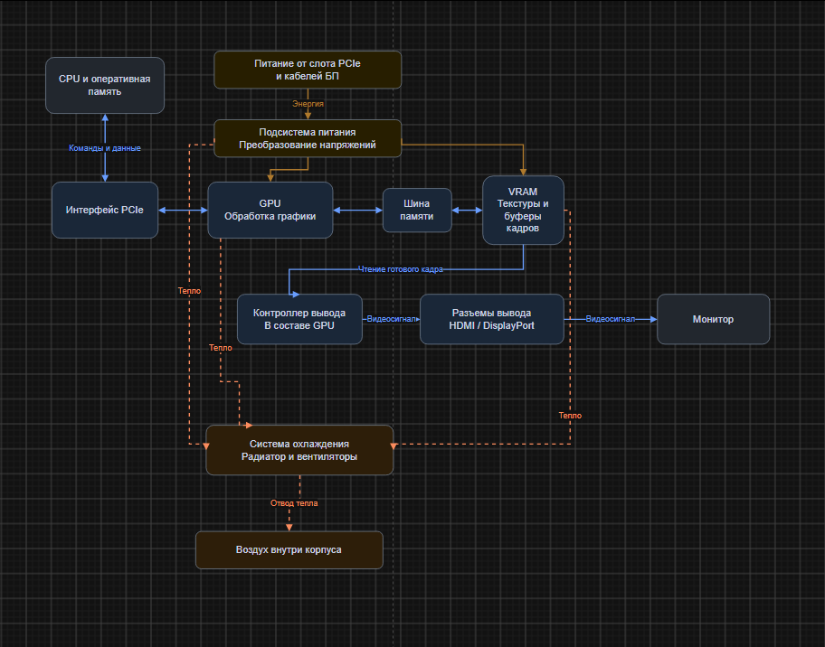

# Занятие 9. Устройство видеокарты

В ветке собраны ответы на вопросы об устройстве видеокарты, схема ее основных блоков и расчеты для NVIDIA GeForce RTX 3060 Ti.

## Материалы

* [homework.md](homework.md) содержит теорию, характеристики видеокарты, расчет пропускной способности памяти и этапы вывода кадра.
* [gpu.png](gpu.png) содержит схему видеокарты с передачей данных, питанием и охлаждением.

## Схема видеокарты

## Основные темы

* Назначение GPU, VRAM, питания и охлаждения.
* Отличия GPU от CPU, SIMT и варпы.
* Расчет пропускной способности видеопамяти.
* Передача данных от CPU к монитору.
* Использование GPU в играх и искусственном интеллекте.

## Вывод

GPU выполняет много похожих вычислений параллельно. Это полезно при обработке графики и работе нейросетей. Для RTX 3060 Ti с 8 ГБ GDDR6 рассчитана пропускная способность памяти 448 ГБ/с.

## Навигация

[Все занятия](https://github.com/Resolushh/Hardware-architecture/tree/main)
