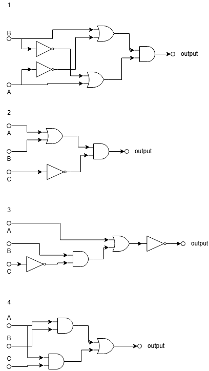
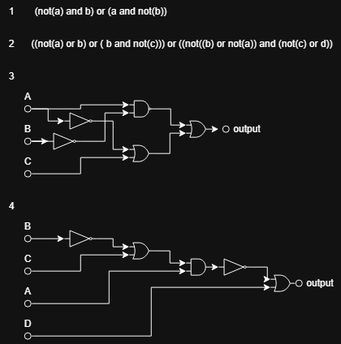

# Занятие 3. Построение логических схем

В ветке собраны схемы для классной и домашней работы. В них используются логические элементы И, ИЛИ и НЕ.

## Классная работа

На изображении представлены четыре логические схемы с разными соединениями элементов.

## Домашняя работа

На изображении записаны два логических выражения и построены ещё две схемы. Подписи входов и выходов помогают проследить, как формируется результат.

## Вывод

Логическую функцию можно представить выражением или схемой. Соединения элементов задают порядок обработки входных сигналов.

## Навигация

[Все занятия](https://github.com/Resolushh/Hardware-architecture/tree/main)
