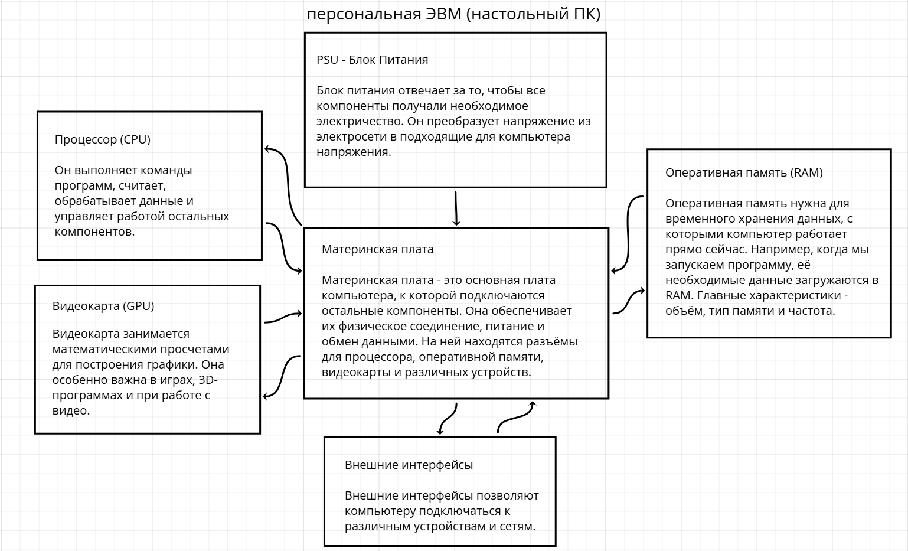

# Занятие 1. Устройство персонального компьютера

На схеме показаны основные компоненты настольного ПК и их связь с материнской платой.

## Схема

## Что показано

- Процессор выполняет команды и обрабатывает данные.
- Оперативная память хранит данные, с которыми компьютер работает сейчас.
- Видеокарта обрабатывает графику.
- Блок питания подаёт питание на компоненты.
- Материнская плата соединяет устройства и обеспечивает обмен данными.
- Внешние интерфейсы позволяют подключать периферию.

## Вывод

Компоненты компьютера выполняют разные задачи и работают вместе благодаря соединениям на материнской плате.

## Навигация

[Все занятия](https://github.com/Resolushh/Hardware-architecture/tree/main)
