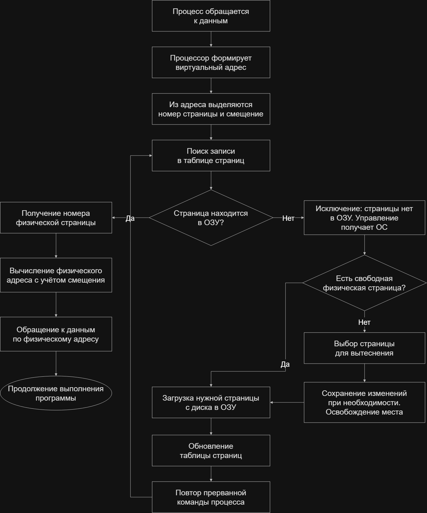

# Урок 6. Путь работы виртуальной памяти

## Назначение виртуальной памяти

Оперативная память компьютера ограничена. Виртуальная память отделяет адресное пространство процесса от физической ОЗУ и позволяет размещать в ней только необходимые в данный момент части программы. Остальные части могут храниться на диске и загружаться по мере обращения к ним.

Программа использует виртуальные адреса. Операционная система управляет размещением страниц, а аппаратный механизм динамического преобразования адресов (ДПА) преобразует виртуальные адреса в физические.

## Схема работы

Схема описывает обращение к допустимой странице, сохранённой на диске. Проверка прав доступа и другие причины исключений здесь опущены.

## Виды адресов

- **Символьный адрес** — имя объекта в программе, например переменной.
- **Виртуальный адрес** — адрес в адресном пространстве процесса.
- **Физический адрес** — адрес данных в оперативной памяти.

При страничной организации виртуальный адрес состоит из номера страницы и смещения внутри неё. ОЗУ разделена на физические страницы такого же размера. Таблица страниц связывает виртуальные страницы процесса с физическими.

## Пошаговый путь обращения к памяти

### 1. Обращение процесса к данным

Выполняемая команда использует виртуальный адрес. Процессор выделяет из него номер виртуальной страницы и смещение.

### 2. Поиск записи в таблице страниц

По номеру виртуальной страницы механизм преобразования адресов находит соответствующую запись в таблице страниц процесса. Она содержит номер физической страницы, если страница присутствует в ОЗУ, и управляющие признаки.

К таким признакам относятся бит присутствия, признак изменения страницы и признак обращения к ней. ОС также ведёт сведения, необходимые для управления подкачкой.

### 3. Проверка присутствия страницы

Если страница находится в ОЗУ, из записи получается номер физической страницы. Начальный адрес этой страницы складывается со смещением:

**Физический адрес = номер физической страницы × размер страницы + смещение.**

Процессор обращается к данным по полученному адресу, после чего выполнение программы продолжается.

### 4. Обработка отсутствующей страницы

Если нужной страницы нет в ОЗУ, возникает исключение отсутствия страницы. Управление получает операционная система, которая проверяет возможность обработки обращения и организует подкачку.

В рассматриваемом случае страница допустима и хранится на диске. Отсутствие страницы в ОЗУ само по себе не всегда означает, что её необходимо читать с диска: например, при первом обращении может понадобиться новая страница памяти.

### 5. Поиск свободной физической страницы

Если в ОЗУ есть свободная физическая страница, ОС использует её для загрузки данных.

Если свободных страниц нет, ОС выбирает страницу для вытеснения. Изменённое содержимое сохраняется на диске при необходимости, затем физическая страница освобождается. Неизменённую страницу с актуальной копией на диске можно вытеснить без повторной записи.

### 6. Загрузка и обновление таблицы

ОС загружает нужную страницу с диска в освобождённую или ранее свободную физическую страницу. Затем обновляет таблицу страниц: указывает физическую страницу и устанавливает признак присутствия.

### 7. Повтор команды

После завершения подкачки прерванная команда выполняется повторно. Теперь нужная страница находится в ОЗУ, поэтому виртуальный адрес успешно преобразуется в физический и процесс получает данные.

## Другие способы организации виртуальной памяти

В презентации рассматриваются также сегментная и сегментно-страничная организация.

- **Сегментная организация:** программа делится на логические части переменного размера. Адрес содержит номер сегмента и смещение. При обращении учитываются начало сегмента, его длина и права доступа.
- **Сегментно-страничная организация:** сегменты дополнительно делятся на страницы. Адрес включает номер сегмента, номер страницы и смещение.

Приведённая выше схема относится к страничной организации.

## Свопинг и подкачка

В терминологии презентации свопинг перемещает между ОЗУ и диском образ процесса целиком. При работе виртуальной памяти перемещаются отдельные части процесса — страницы или сегменты.

ОС определяет, когда загружать данные, где их размещать и какие страницы вытеснять при нехватке памяти.

## Итоговый маршрут

Обращение к виртуальному адресу → выделение номера страницы и смещения → поиск записи в таблице страниц → проверка присутствия → при необходимости освобождение места и подкачка → обновление таблицы → повтор команды → вычисление физического адреса → обращение к данным.

## Источник

Учебная презентация «Управление памятью», раздел о виртуальной памяти, слайды 74–98.
