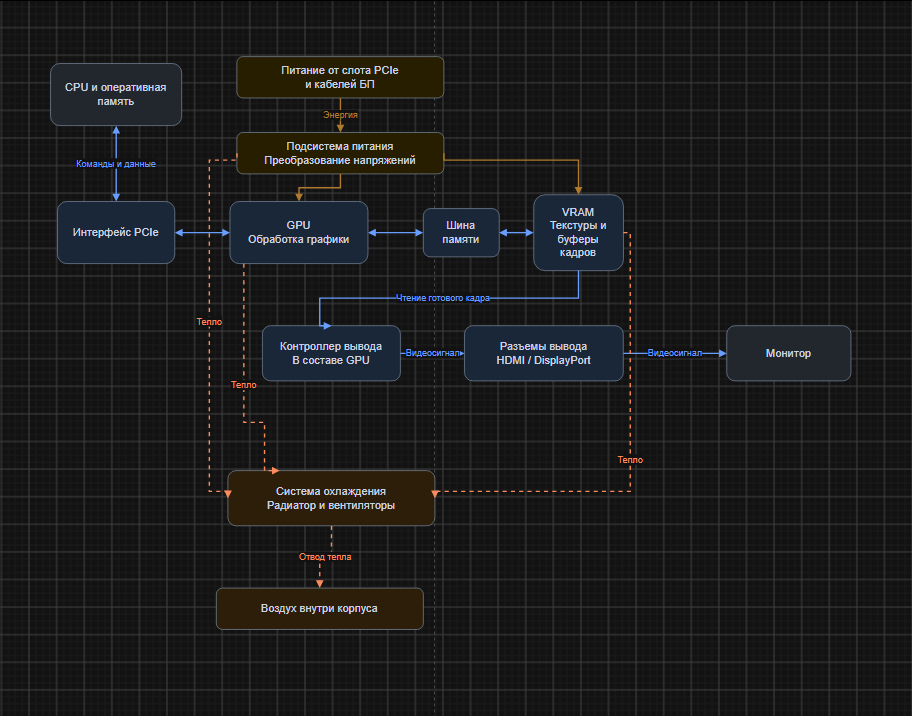

# Домашняя работа по устройству видеокарты

## Часть 1. Теория

### 1. Основные блоки видеокарты

1. GPU выполняет расчеты графики: обрабатывает вершины, освещение и пиксели.
2. VRAM хранит текстуры, модели и буферы кадров.
3. Подсистема питания преобразует напряжение от БП и слота PCIe для GPU и памяти.
4. Система охлаждения отводит тепло от GPU, VRAM и элементов питания.
5. Блок интерфейсов связывает видеокарту с компьютером через PCIe и выводит изображение через HDMI или DisplayPort.

### 2. Отличия GPU от CPU

1. У CPU меньше сложных ядер, у GPU много вычислительных блоков для похожих операций.
2. CPU рассчитан на быстрое выполнение отдельных потоков, GPU на одновременную обработку большого числа потоков. Пока одни ждут данные, GPU выполняет другие.

CPU подходит для логики игры, работы ОС и задач с частыми условиями. GPU подходит для обработки графики, видео и матриц.

### 3. Что такое VRAM

VRAM является памятью видеокарты для данных GPU. Обычная RAM хранит данные всей системы и подключена к CPU. Быстрая VRAM нужна, чтобы GPU успевал читать текстуры и записывать результаты без простоев.

### 4. SIMT и варпы

SIMT означает, что группа потоков выполняет общую команду, но каждый поток работает со своими данными. У NVIDIA варп состоит из 32 потоков. Такое объединение упрощает управление и позволяет выполнять много одинаковых расчетов одновременно. Если потоки идут по разным ветвям условия, эффективность снижается.

### 5. Питание и охлаждение

Подсистема питания создает стабильные напряжения для GPU и VRAM. Охлаждение отводит выделяемое тепло. При перегреве видеокарта снижает частоты, из-за чего падает производительность. Если этого недостаточно, возможны сбои и защитное отключение.

## Часть 2. Схема видеокарты



Синие стрелки показывают данные и видеосигнал, желтые питание, оранжевые пунктирные отвод тепла.

## Часть 3. Практика

### 1. Характеристики моей видеокарты

Через `nvidia-smi` определил модель: **NVIDIA GeForce RTX 3060 Ti**. Объем памяти и лимит мощности взял из утилиты, остальные данные из спецификации.

* VRAM: 8 ГБ GDDR6.
* Шина памяти: 256 бит.
* Ядра CUDA: 4864.
* Мощность карты: 200 Вт.
* Эффективная скорость памяти: 14 Гбит/с на контакт.
* Паспортная пропускная способность: 448 ГБ/с.

### 2. Расчет пропускной способности памяти

Для формулы беру эффективную скорость 14 000 Мбит/с на контакт. Показание `nvidia-smi` 7001 МГц соответствует примерно 14 Гбит/с с учетом передачи данных.

```text
Пропускная способность = эффективная скорость × ширина шины / 8

14 000 × 256 / 8 = 448 000 МБ/с = 448 ГБ/с
```

Деление на 8 переводит биты в байты. Результат **448 ГБ/с** совпадает с паспортным значением. Это теоретическая пропускная способность.

### 3. Что происходит после запуска игры

1. ОС запускает игру, файлы загружаются с накопителя в RAM.
2. CPU обрабатывает ввод, игровую логику и готовит команды для GPU.
3. Через драйвер и PCIe команды поступают к GPU, а текстуры и модели загружаются в VRAM.
4. GPU обрабатывает геометрию, рассчитывает цвета и освещение, используя данные из VRAM.
5. Готовый кадр записывается в буфер VRAM.
6. Контроллер вывода считывает кадр и передает сигнал через HDMI или DisplayPort на монитор.

## Часть 4. Вывод

GPU выполняет много похожих вычислений параллельно, поэтому подходит и для игр, и для ИИ. В нейросетях много операций с матрицами, которые удобно распределять между вычислительными блоками. Быстрая VRAM хранит данные и передает их GPU.

## Источники

* [Характеристики NVIDIA RTX 3060 Ti](https://www.nvidia.com/en-us/geforce/graphics-cards/30-series/rtx-3060-ti/).
* [RTX 3060 Ti GDDR6 и пропускная способность памяти](https://www.palit.com/palit/vgapro.php?id=4269&lang=en&pn=NE6306TS19P2-190AD&tab=sp).
* [NVIDIA о SIMT и варпах](https://developer.nvidia.com/blog/using-cuda-warp-level-primitives/).
